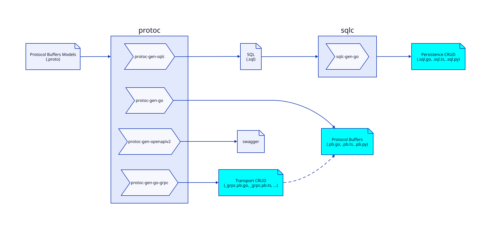
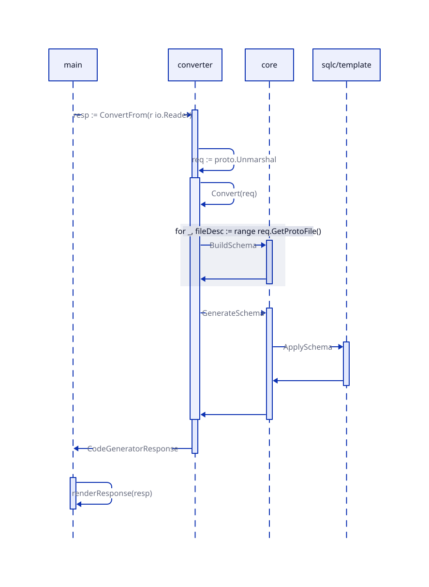

# protoc-gen-sqlc

[](https://pkg.go.dev/github.com/pablojimpas/protoc-gen-sqlc/)
[](https://github.com/pablojimpas/protoc-gen-sqlc/actions/workflows/go.yaml)
[](https://goreportcard.com/report/github.com/pablojimpas/protoc-gen-sqlc)

Protocol Buffers plugin to generate SQL schema and queries with
[sqlc](https://sqlc.dev/) annotations.

## Why?

Describe a library book and its author in Protobuf, mark their keys and
relationship, and inspect the resulting tables and queries before compiling
them into typed application code with sqlc. The
[library definitions](proto/examples/library/v1) and
[generated SQL](examples/library/internal/gen/pb/sqlc) show both sides of
that contract.

This is an experimental generator. The included example targets PostgreSQL
and Go with pgx. It generates a schema for an empty database and named CRUD
queries. Existing databases need a migration plan when the schema changes.
The generator currently treats every top-level message in its input as a
table. Limit generation to files containing persistence models.

From a checkout with Go and the Go binary directory on your PATH, run
`make sqlc` to rebuild the plugin and regenerate the library SQL and Go
bindings. Run `make test` to exercise the Go test suite.

## Install

You can download and compile the latest version from source using Go directly:

```shell
go install github.com/pablojimpas/protoc-gen-sqlc/cmd/protoc-gen-sqlc@latest
```

or you can download pre-built binaries from the [Github releases
page](https://github.com/pablojimpas/protoc-gen-sqlc/releases/latest).

## Usage

### With `buf`

To use `buf` you have to make a config file called `buf.gen.yaml` with your
options, like this:

```yaml
version: v2
plugins:
  - local: protoc-gen-sqlc
    out: out
```

And then run `buf generate`. See [the documentation on buf
generate](https://buf.build/docs/reference/cli/buf/generate#usage) for more
help.

### With `protoc`

This plugin works with `protoc` as well. Here's a basic usage example:

```shell
protoc example.proto --sqlc_out=gen
```

## General Idea



## Schema Build Process


